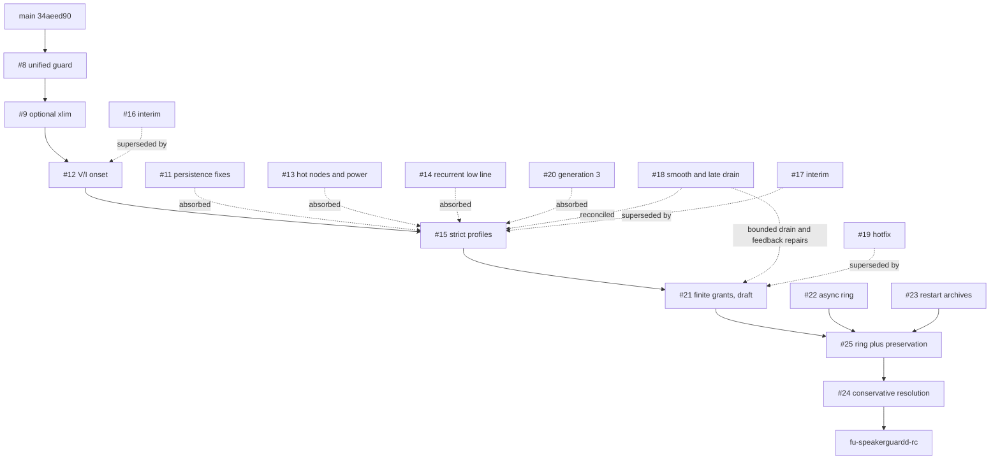

# Release candidate integration map

Snapshot: 2026-10-31. Main baseline: `34aeed9085ad0f66cb8f266f997e11dd781470a6`. All 19 open PRs are accounted for: 17 RyanTheTide and two report-only erikwb PRs. Original branches are preserved.

## Merge-order graph

Dashed edges describe semantic absorption, not rewritten Git ancestry. Direct merges use `--no-ff`. #25 already has merge ancestry for #22 and #23. The RC merge of #24 keeps the stricter implementation and documents the deferred feature.

## Every open PR

| PR / author | Exact base | Head | Change | Disposition and conflicts |
| --- | --- | --- | --- | --- |
| [#8](https://github.com/aurora-silicon/speakerguardd/pull/8) RyanTheTide | `fix/fail-closed-0.1.3` (`ff79908d78e8`) | `9b54f813a48c` | Unified V/I guard, profiles, replay and harness | merge 1. mainline J700 queue/floor and resident-memory behavior must be retained |
| [#9](https://github.com/aurora-silicon/speakerguardd/pull/9) RyanTheTide | `main` (`c8fa2a541f9e`) | `3481d20de2ae` | Optional LADSPA excursion/peak limiter | merge 2. independent filter/ addition; never enabled by this candidate |
| [#10](https://github.com/aurora-silicon/speakerguardd/pull/10) erikwb | `integration/recording-ring-preservation` (`a9daa66e097b`) | `d3f398208696` | J713 unqualified profile | report only, excluded. based on #25; profile and native stream data need separate review; no branch modifications |
| [#11](https://github.com/aurora-silicon/speakerguardd/pull/11) RyanTheTide | `wip/ee-fix-20261026` (`36bf6b63804c`) | `70f73cb843e3` | RTC-bounded opt-in clean reboot restore | absorbed by #15. equivalent final repair patches; initial persistence commits were subsequently hardened |
| [#12](https://github.com/aurora-silicon/speakerguardd/pull/12) RyanTheTide | `wip/sg8-line2-20261026` (`5c1485f15218`) | `62cf38640eb7` | Reserve full possible V/I onset dose before writes | merge 3. full fix replaces interim #16 |
| [#13](https://github.com/aurora-silicon/speakerguardd/pull/13) RyanTheTide | `main` (`34aeed9085ad`) | `3a95d643aaf3` | Independent legacy hot nodes and r_ff power | absorbed by #15. both correction patches are patch-equivalent in #15 |
| [#14](https://github.com/aurora-silicon/speakerguardd/pull/14) RyanTheTide | `wip/ee-fix-20261026` (`36bf6b63804c`) | `61d4f8a04664` | Retain minimum low-line reference over recovery | absorbed by #15. repair patch is patch-equivalent in #15 |
| [#15](https://github.com/aurora-silicon/speakerguardd/pull/15) RyanTheTide | `fix/vi-onset-energy` (`62cf38640eb7`) | `2c17b8d581f1` | Every-profile thermal bounds, generation 3, persistence, smooth attenuation | merge 4. retains the full-dose reserve and unmodified listening assertions |
| [#16](https://github.com/aurora-silicon/speakerguardd/pull/16) RyanTheTide | `unified/rework-20261024` (`9b54f813a48c`) | `851665950cec` | Deployed-base V/I onset backport | superseded by #12/#15. older base and narrower profiles; do not replace full fix |
| [#17](https://github.com/aurora-silicon/speakerguardd/pull/17) RyanTheTide | `main` (`34aeed9085ad`) | `0886ed24c464` | Neo hot-node/minimum-write interim | superseded by main + #13/#15/#20. full independent hot bounds and no-events minimum are in #15 |
| [#18](https://github.com/aurora-silicon/speakerguardd/pull/18) RyanTheTide | `fix/every-profile-limits` (`117c07bfad92`) | `cf4a3ee73fd6` | Smooth attenuation and bounded retained-period drain | absorbed by #15/#21. smooth changes reconciled in #15; #21 retains bounded drain plus feedback/fault repairs |
| [#19](https://github.com/aurora-silicon/speakerguardd/pull/19) RyanTheTide | `unified/rework-20261024` (`9b54f813a48c`) | `46dcd796ad55` | Deployed smooth attenuation hotfix | superseded by #18/#15/#21. retained counterexamples show continuous thermal violations on this older path |
| [#20](https://github.com/aurora-silicon/speakerguardd/pull/20) RyanTheTide | `fix/neo-hot-start-interim` (`0886ed24c464`) | `1de4cde4dcfc` | Reject pre-hot-bound generation 2 runtime state | absorbed by #15. generation 3 and public-writer compatibility fixture retained in #15 |
| [#21](https://github.com/aurora-silicon/speakerguardd/pull/21) RyanTheTide | `fix/every-profile-limits` (`2c17b8d581f1`) | `f5c5f593ba8a` | Finite playback grants and transfer proof; strict listening gates | merge 5, draft. no physical certificate selected; production unqualified paths retain fallback/refusal |
| [#22](https://github.com/aurora-silicon/speakerguardd/pull/22) RyanTheTide | `fix/playback-energy-grants` (`f5c5f593ba8a`) | `7c09c825e170` | Bounded async recorder ring | absorbed by #25. production async/create_new semantics retained in #25 |
| [#23](https://github.com/aurora-silicon/speakerguardd/pull/23) RyanTheTide | `fix/every-profile-limits` (`2c17b8d581f1`) | `105b9bd60e7c` | Preserve restart evidence with archive budget | absorbed by #25. combined helper includes partial-archive accounting and failed-deletion regression |
| [#24](https://github.com/aurora-silicon/speakerguardd/pull/24) RyanTheTide | `fix/pr8-deployed-base-2f7d16d` (`2f7d16db0313`) | `c29bd9385e8b` | Durable checkpoints and governed cross-OS hot starts | merge 7, conservative resolution; partial feature deferred. reject assumed 30-second cooling and marker-only fast reboot; keep stricter #11/#15/#20; active durable resume deferred |
| [#25](https://github.com/aurora-silicon/speakerguardd/pull/25) RyanTheTide | `fix/playback-energy-grants` (`f5c5f593ba8a`) | `a9daa66e097b` | Reconcile #22 ring and #23 restart preservation | merge 6. contains both original branch heads by merge ancestry |
| [#26](https://github.com/aurora-silicon/speakerguardd/pull/26) erikwb | `integration/recording-ring-preservation` (`a9daa66e097b`) | `91c55193a778` | Clean recorder seal, finish, replayed stop and close accounting | report only, excluded. addresses certification gaps retained in #25; four regressions need separate authorized integration |

## Conflict decisions

* #8 versus main: Cargo identity stays on the newer release line; the V/I-aware guard is used. Mainline J700 queue-threat checks, floor, safe-level verification, resident memory and latency counters are retained by integration fixes. Its independent J700 harness and focused queue/floor witnesses remain in the candidate.
* #9, #12, #15, #21 and #25 merge without textual conflict after #8 resolution. Mainline model changes remain alongside the later hot-node and resistance repairs.
* #24 overlaps Makefile, README, three profiles, service, config, engine, guard, main, state and recording helpers. The #25 ring/preservation code and #11/#15/#20 startup implementation win. No assumed cross-OS cooling, marker-only ownership proof, shortened onset dose, new suspend hook or device-specific deployment packaging is introduced.

## Disposition after eventual acceptance

The interim PRs #16, #17 and #19 are superseded; #20 is absorbed by the full generation-3 implementation. #11, #13, #14, #18, #22 and #23 are represented in the integrated later stack. These are suggested closure candidates only after the RC is accepted. No PR is closed by this work. #24 active durable resume remains deferred and must not be described as delivered. #10 and #26 remain separate and untouched.

## Protection and profile coverage

The full-dose onset reserve, low-line minimum, both-node hard limits, unqualified-profile admission, state generation checks, recorder refusal of incomplete evidence and kernel lease remain effective. Physical TAS/AOP transfer qualification remains absent; synthetic reference grants do not qualify hardware. Listening failures remain release failures.

Host fixtures cover every shipped profile, including J700, J616, J313, J314/J316 and J413. J313 is the M1 Air profile; T6000 uses J314/J316, so both the requested J313 profile and actual T6000 profiles are checked. No hardware or audio qualification is claimed. Raw fleet recordings are not used or published.

## Outside-contributor interaction (report only)

#10 is a J713 profile stacked on #25. Its 12-channel mapping and tweeter impedance corrections interact with profile parsing, qualification and full-scale onset tests; it depends on #26 to certify its linked recording. The RC retains the pre-existing generic unqualified J713 draft, without importing #10.

#26 is stacked on #25 and fixes missing async-writer drain at clean stop, missing clean ring seal, replayed-stop timing and stream-close accounting. Excluding it leaves those known live-recording certification limitations in the candidate. The RC does not claim its fake-card replay tests establish live certification. No source from #10 or #26 is merged, edited, closed or pushed.
